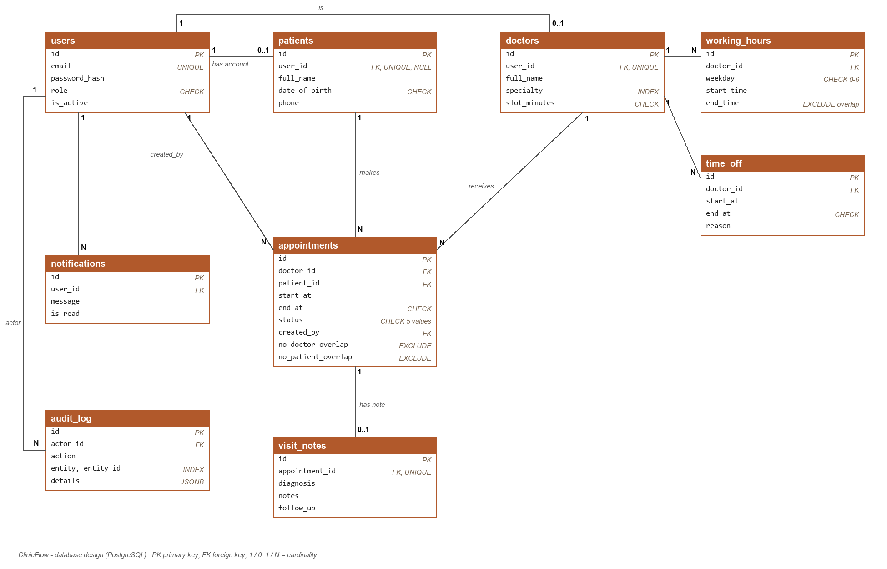

# ClinicFlow – Alpha

**Team:** Denys Konovalov (solo; responsible for database, API, frontend, tests and demo).

## Run

Requires Docker and Python 3.11+.

```bash
docker compose up -d                      # PostgreSQL on localhost:5433, schema.sql applied automatically
python -m venv .venv
.venv\Scripts\pip install -r requirements.txt     # Linux/macOS: .venv/bin/pip
.venv\Scripts\python -m uvicorn app.main:app --port 8000
```

Open http://localhost:8000 (API docs: /docs). Demo accounts (password `password`): `admin@clinic.test`, `reception@clinic.test`, `dr.smith@clinic.test`, `dr.lee@clinic.test`. Patients register themselves.

## End-to-end scenario (implemented)

Register → log in → search doctors → pick a date → see free slots → book → see it in "My appointments" → cancel (24 h rule).

| Step | Frontend | Backend | Database |
|---|---|---|---|
| Register / login | form → `POST /auth/register`, `/auth/login` | hash password (PBKDF2), issue JWT (60 min) | `users`, `patients` rows; email `UNIQUE` → 409 |
| Free slots | date picker → `GET /doctors/{id}/slots` | working hours − time off − active appointments | reads `working_hours`, `time_off`, `appointments` |
| Book | click slot → `POST /appointments` | role check (patient), re-check slot, insert | `EXCLUDE` constraints reject overlap → 409 |
| Cancel | button → `POST /appointments/{id}/cancel` | ownership + state + 24 h check | `status='cancelled'`, slot free again; `audit_log` row |

Verified: second booking of the same slot → 409; booking an overlapping slot with another doctor → 409.

## Database design

Full DDL: [schema.sql](schema.sql) (all planned tables exist; the API uses a subset so far).



**Key decisions**
- `patients` is separate from `users` so receptionists can register walk-in patients with no account (`user_id` nullable, unique).
- Free slots are not stored; they are computed from `working_hours`/`time_off`/`appointments`, so there is one source of truth.
- Double-booking is prevented **in the database**: `EXCLUDE USING gist (doctor_id =, tstzrange(start_at,end_at) &&) WHERE status IN ('booked','checked_in','completed')`. A cancelled/no-show appointment drops out of the constraint, so the slot is bookable again. The same pattern on `patient_id` enforces FR11.
- Checks: role, status, `slot_minutes IN (15,20,30,60)`, `start < end`, weekday 0–6, DOB in the past; `working_hours` intervals of one doctor cannot overlap.
- Visit notes live in their own table so access rules (patient + authoring doctor only) are enforced on one endpoint.

**Indexes:** `users.email` (unique), `doctors(specialty)`, `appointments(doctor_id,start_at)`, `appointments(patient_id,start_at)`, `time_off(doctor_id,start_at)`, `notifications(user_id,is_read)`, `audit_log(entity,entity_id)`, `audit_log(created_at)`, plus the GiST indexes behind the exclusion constraints.

## UX/UI

Early real frontend: [static/index.html](static/index.html), served by FastAPI.

Screens and flows:
1. **Login / Register** → on login, routed by role.
2. **Patient:** doctor search by specialty → date → slot buttons → book → *My appointments* (with Cancel).
3. **Planned (Beta):** receptionist daily schedule with check-in / no-show; doctor agenda and visit-note form; admin accounts, audit log, report.

## Responsibilities and contribution

Denys Konovalov: everything so far – schema design, FastAPI backend, PostgreSQL integration, frontend, Docker setup, README.
Implemented FRs: FR1, FR2, FR4 (partly), FR8, FR9, FR10, FR11, FR12 (patient side), FR23 (booking/cancel events only).

## Changes to Stage 1 requirements

None to the requirement list. Technical note: appointment times are stored as `timestamptz`; slots are generated in the server's local timezone (single clinic).

## Open risks

- Role-specific endpoints (reception, doctor, admin) and the state machine beyond booked→cancelled are not built yet.
- Time zone / daylight-saving handling for slot generation needs tests.
- No automated tests yet; concurrency test for double-booking is planned for phase 5.
- Dev-only JWT secret default (`JWT_SECRET` env var in production).
